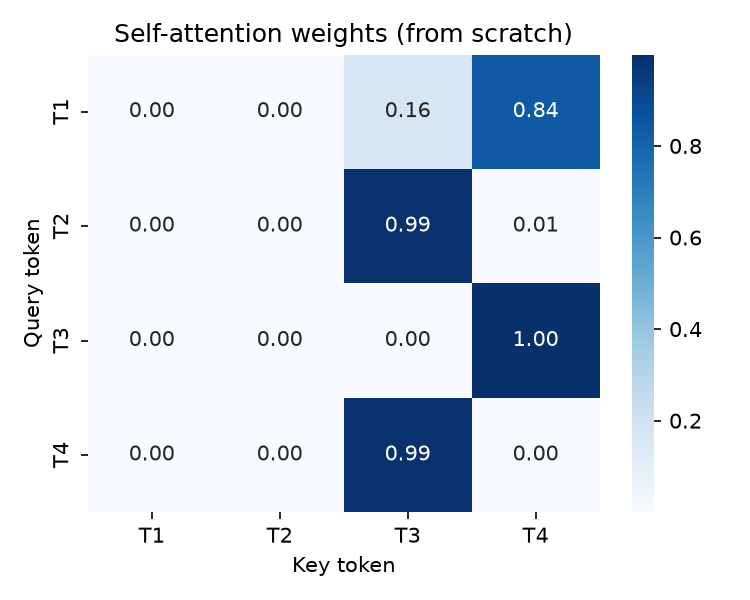
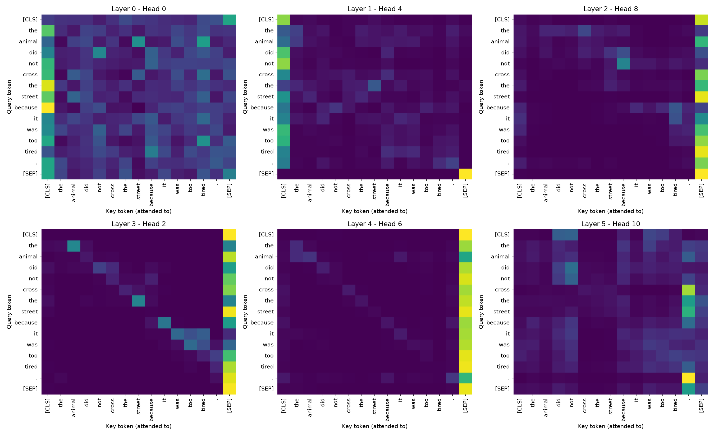
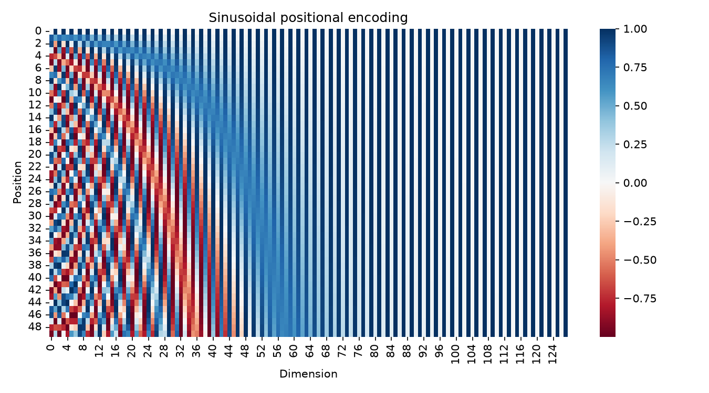
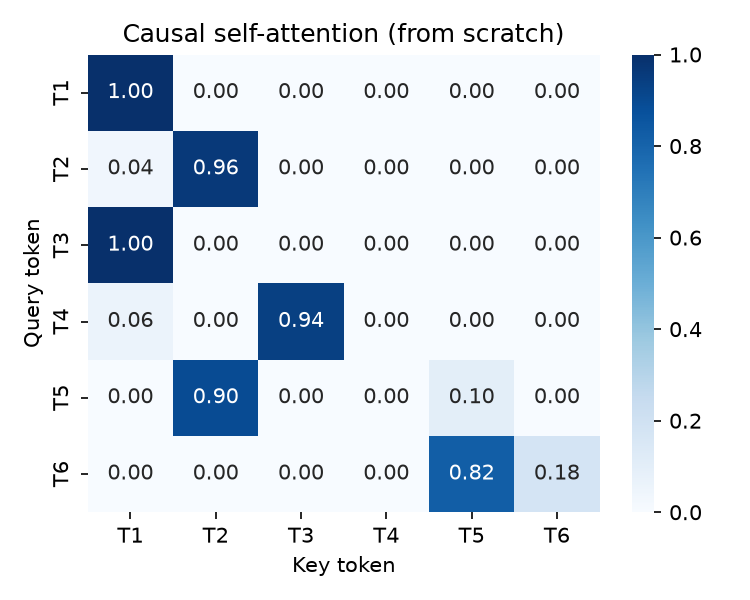
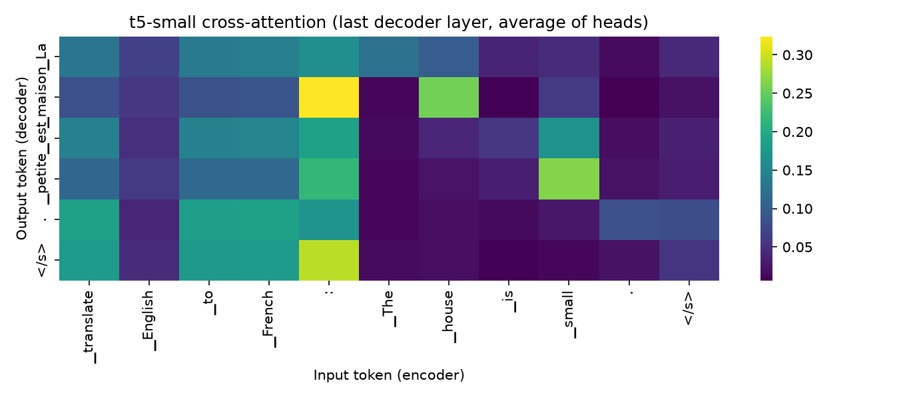
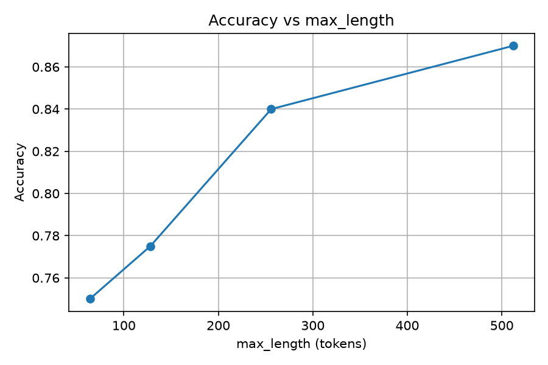
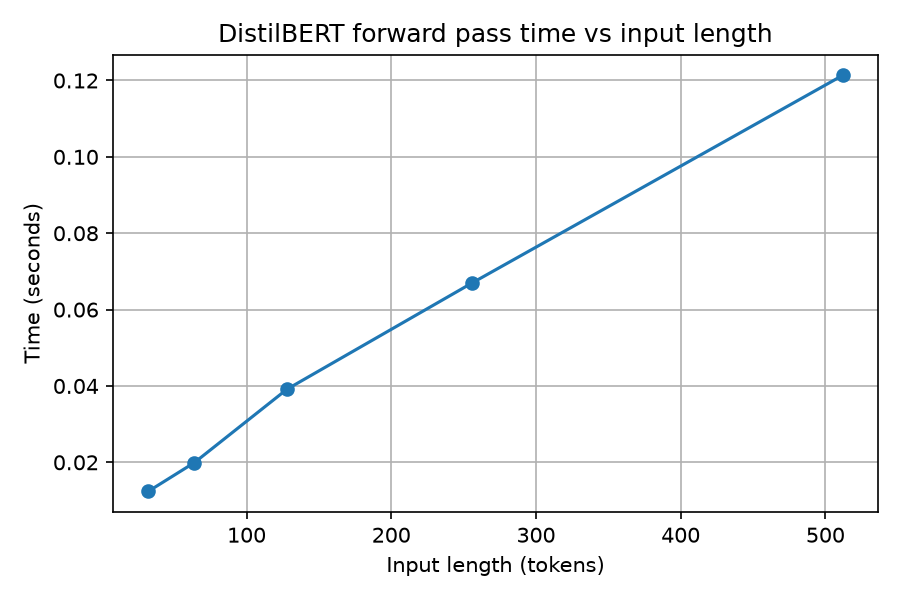

<div align="center">
<br>


<br>

[](#)
[](#)
[-F5C518?style=for-the-badge&logo=imdb&logoColor=black)](https://huggingface.co/datasets/stanfordnlp/imdb)
[](#-models-used)

<br>


</div>

<br>

## 🎬 Video Walkthrough

<div align="center">

[](#)


🎥 **A complete video explanation (face + screen, 5–10 min)** covering Q, K, V and why scores are divided by √d_k, what multi-head attention adds, why positional encoding is needed, LayerNorm vs BatchNorm, encoder vs decoder and masked attention, cross-attention using the heatmap, token-by-token inference with the KV-cache, one measured disadvantage, and a live `text_toolkit()` demo on a new passage.


> 📌 *Click the button above or [open the video directly →]()*

</div>

---

## 🎯 About This Project

> A Transformer looks complicated from outside, but inside it is only a few simple ideas repeated many times: compare tokens, mix their values, normalise, and repeat. The best way to understand it is to rebuild the key parts and check them against a real model.

This project **trains nothing**. It downloads three small pretrained Hugging Face models — one for each Transformer family — and opens them up: it rebuilds scaled dot-product attention, positional encoding, LayerNorm and the causal mask in plain NumPy, **verifies them against the real models**, and then uses the models for sentiment analysis, translation, summarisation and text generation. In the last task it measures two disadvantages of Transformers on real data and wraps three models into one `text_toolkit()` function.

<div align="center">

```
░░░░░░░░░░░░░░░░░░░░░░░░░░░░░░░░░░░░░░░░░░░░░░░░░░░░░░░░░░░
   Pipelines → Tokenizer → Model anatomy
   ───────────────────────────────────────────────────────
   Attention from scratch → Verify with DistilBERT
   ───────────────────────────────────────────────────────
   Multi-head → Positional encoding → LayerNorm
   ───────────────────────────────────────────────────────
   Encoder → Causal mask → Cross-attention → Inference
   ───────────────────────────────────────────────────────
   Evaluation → Cost vs length → Hallucination → text_toolkit()
░░░░░░░░░░░░░░░░░░░░░░░░░░░░░░░░░░░░░░░░░░░░░░░░░░░░░░░░░░░
```

</div>

<br>

---

## 🤖 Models Used

| Experiment | Hugging Face model ID | Family | Layers / Heads | Parameters |
|:---|:---|:---|:---:|:---:|
| Sentiment, attention study, encoder anatomy | `distilbert-base-uncased-finetuned-sst-2-english` | Encoder-only | 6 / 12 | 66,955,010 |
| Fill-mask | `distilbert-base-uncased` | Encoder-only | 6 / 12 | – |
| Causal mask, generation, decoding, KV-cache, hallucination | `gpt2` | Decoder-only | 12 / 12 | – |
| Translation, summarisation, cross-attention | `t5-small` | Encoder-decoder | 6 + 6 / 8 | – |

<br>

---

## 📚 Dataset

| Item | Detail |
|:---|:---|
| **Name** | IMDB movie reviews |
| **Hugging Face** | [stanfordnlp/imdb](https://huggingface.co/datasets/stanfordnlp/imdb) |
| **Loading** | `load_dataset("stanfordnlp/imdb", split="test").shuffle(seed=42).select(range(200))` |
| **Size** | 200 reviews with labels (0 = negative, 1 = positive) |
| **Use** | Evaluation only — **no training or fine-tuning** |
| **Long reviews** | 18 of 200 reviews are longer than 512 tokens (the model limit) |
| **Other text** | 3 own passages (review, news paragraph, own text) for `text_toolkit()` |
| **Licence** | Free for research and educational use |

**Citation**

> Maas, A. L., Daly, R. E., Pham, P. T., Huang, D., Ng, A. Y., & Potts, C. (2011). *Learning Word Vectors for Sentiment Analysis.* Proceedings of the 49th Annual Meeting of the Association for Computational Linguistics (ACL 2011). Stanford AI Lab.

> ⚠️ The dataset and models are public and are downloaded automatically on the first run, then cached. No Hugging Face account is needed.

<br>

---

## ✨ What Makes This Project Stand Out

<table>
<tr>
<td width="50%" valign="top">

### 🧮 Built by Hand, Then Verified
- Scaled dot-product attention written in plain NumPy with shapes printed and row sums checked
- Layer 0, head 0 of DistilBERT recomputed from its `q_lin` / `k_lin` weights — `np.allclose` returned **True** (max difference **4.1 × 10⁻⁸**)
- LayerNorm from scratch matched `torch.nn.LayerNorm`
- Causal mask built in NumPy, then confirmed inside GPT-2

</td>
<td width="50%" valign="top">

### 🔍 Real Models, Opened Up
- Six real attention heads plotted with token labels
- Attention entropy per head, learned position vectors, parameter share by component
- Cross-attention heatmap from `t5-small`
- Manual greedy loop on GPT-2 gave text **identical** to `generate()`

</td>
</tr>
<tr>
<td width="50%" valign="top">

### 📉 Disadvantages, Measured
- Accuracy vs `max_length` (64 / 128 / 256 / 512) with time
- Forward-pass time vs input length (32 to 512 tokens)
- Hallucination check on three factual prompts
- KV-cache speed-up measured on CPU

</td>
<td width="50%" valign="top">

### 🔍 Honest Reporting
- Results reported as measured, including surprises: the fill-mask model did **not** return "Paris" in its top 3, and the cross-attention alignment is weak
- The time-vs-length curve is **not** quadratic on CPU, and the text explains why
- `transformers` v5 removed the `summarization` and `translation` pipelines, so `t5-small` is called directly with `generate()`

</td>
</tr>
</table>

<br>

---

## 🗺️ Full Project Journey

<div align="center">

| Task | Focus | Key Output |
|:---:|:---|:---|
| 🚀 **Task 1** | Pipelines, history, tokenizer, model anatomy | Sentiment on 5 sentences · timeline · tokens, ids and attention mask · padded batch · config table |
| 🎯 **Task 2** | Self-attention and scaled dot-product attention | NumPy attention · √d_k experiment · Luong attention · order-blindness proof · match with DistilBERT |
| 🧩 **Task 3** | Multi-head attention, positional encoding, LayerNorm | 6 real heads · entropy per head · sinusoidal PE · learned positions · LayerNorm vs BatchNorm |
| 🏗️ **Task 4** | Encoder and masked self-attention | Module table · parameter shares · fill-mask · bidirectional vs causal heatmaps · padding mask |
| 🔀 **Task 5** | Cross-attention, decoder and inference | Translation and summary · cross-attention plot · manual greedy loop · 5 decoding strategies · KV-cache |
| 🏁 **Task 6** | Evaluation, disadvantages, mini application | 200-review evaluation · truncation study · cost vs length · hallucination check · `text_toolkit()` |

</div>

<br>

---

## 🧠 The Key Ideas in One Paragraph Each

### 🎯 Self-attention
Every token is turned into a **Query** (what am I looking for), a **Key** (what do I offer) and a **Value** (what do I pass on). The new vector of a token is a weighted average of all Value vectors, with weights `softmax(Q·Kᵀ / √d_k)`. Dividing by √d_k matters: in the experiment, at `d_k = 256` the average maximum softmax probability was **0.916 without scaling** and **0.121 with scaling**, so unscaled softmax is saturated (one weight close to 1, gradients almost vanish).

<div align="center">



*Attention weights built from scratch (4 tokens, d_model = 8). Every row sums to 1 and the same code matches layer 0, head 0 of DistilBERT.*

</div>

### 🧩 Multi-head attention
One attention pattern is not enough. With 12 heads, the 768-dimensional space is split into 12 parts of 64, and each head learns its own pattern. In the plotted heads, several heads look mainly at `[SEP]` (shares of 0.63, 0.69 and 0.86) or at `[CLS]` (0.47), and none of the six linked "it" to "animal" — so not every head is easy to explain.

<div align="center">



*Six real DistilBERT heads from different layers for "The animal did not cross the street because it was too tired."*

</div>

### 📍 Positional encoding
Attention is **order-blind**: shuffling the input only shuffled the output rows (`np.allclose` returned True). Adding positional information fixes this — after adding sinusoidal PE, the same word at positions 3 and 20 had cosine similarity **0.868** instead of 1.0. DistilBERT does not use sinusoids; it **learns** 512 position vectors, and this table size is the origin of its 512-token context limit.

<div align="center">



*Sinusoidal positional encoding (50 positions, 128 dimensions). Low dimensions change fast and high dimensions change slowly, so every position gets a unique pattern.*

</div>

### 📏 Layer normalization
LayerNorm normalises each **token** over its own features, so it does not depend on batch size or padding. The NumPy version gave per-token mean 0 and std 1 and matched `torch.nn.LayerNorm`. A BatchNorm on the same matrix normalised each feature across tokens, and the per-token statistics were **not** 0 and 1 — which is why Transformers use LayerNorm.

### 🔒 Masked (causal) attention
A mask of −∞ above the diagonal is added **before** the softmax, so a token cannot see future tokens and each row still sums to 1. The hand-made mask gave a clean lower-triangular matrix, and in GPT-2 the values above the diagonal were almost zero (`np.triu(...) < 1e-6`). DistilBERT, an encoder, has weights on both sides of the diagonal.

<div align="center">



*Causal self-attention built from scratch (6 tokens). Each token attends only to itself and earlier tokens.*

</div>

### 🔀 Cross-attention
In cross-attention the **Queries come from the decoder**, while the **Keys and Values come from the encoder output**, so the decoder can look at the source sentence while writing the target sentence.

<div align="center">



*`t5-small` cross-attention, last decoder layer, average over 8 heads (rows = output tokens, columns = input tokens).*

</div>

### ⚙️ Inference
A decoder generates **one token at a time** and feeds it back as input. The manual greedy loop on GPT-2 (20 new tokens) produced text **identical** to `model.generate(do_sample=False)`. Earlier keys and values never change, so the **KV-cache** stores them instead of recomputing them at every step.

<br>

---

## 🧱 Model Anatomy

DistilBERT has 66,955,010 parameters (6 layers, 12 heads, hidden size 768, vocabulary 30,522, 512 positions).

| Component | Parameters | Share |
|:---|:---:|:---:|
| Embeddings | 23,834,112 | 35.60 % |
| Attention | 14,174,208 | 21.17 % |
| Feed-forward (768 → 3072 → 768) | 28,334,592 | **42.32 %** |
| Layer norms | 19,968 | 0.03 % |
| Classification head | 592,130 | 0.88 % |

Most parameters sit in the feed-forward layers and the embeddings, not in attention — so a large part of what the model "knows" is stored there.

<br>

---

## 📈 Results Summary

### Sentiment evaluation (no training, 200 IMDB reviews, `max_length = 512`)

<div align="center">

| Metric | Value |
|:---|:---:|
| **Accuracy** | **0.870** |
| Precision | 0.889 |
| Recall | 0.833 |
| F1 score | 0.860 |

*The model was fine-tuned earlier on a different dataset (SST-2); nothing was trained in this project.*

</div>

### Verification checks

<div align="center">

| Check | Result |
|:---|:---:|
| Hand-made attention vs DistilBERT (layer 0, head 0) | ✅ Match, max difference 4.1 × 10⁻⁸ |
| Hand-made LayerNorm vs `torch.nn.LayerNorm` | ✅ Match |
| Shuffled input gives shuffled output | ✅ True |
| GPT-2 attention above the diagonal | ✅ Almost zero |
| Attention received by padding positions | ✅ 0 |
| Manual greedy loop vs `generate()` | ✅ Identical |

</div>

### Fill-mask (encoder, top-3)

| Sentence | Top-3 predictions |
|:---|:---|
| The capital of France is `[MASK]`. | marseille (0.143), nantes (0.090), toulouse (0.088) |
| I would like a cup of `[MASK]` this morning. | coffee (0.651), tea (0.253), water (0.034) |
| She opened the door and `[MASK]` into the room. | stepped (0.252), walked (0.170), peered (0.047) |

The model uses words on both sides of the mask. For the first sentence, "paris" is not in the top 3, so a fill-mask model is not a fact database.

### Decoding strategies (GPT-2, prompt "Artificial intelligence will")

| Strategy | Observation |
|:---|:---|
| Greedy | Fluent, deterministic |
| Beam (5) | Fluent, deterministic, repeats the phrase "a lot of work" |
| Temperature 0.7 (two seeds) | Readable, but the two seeds give different texts |
| Temperature 1.5 (two seeds) | Random, partly nonsense words |
| Top-k 50 + top-p 0.9 | Random, but cuts very unlikely tokens |

### KV-cache (100 new tokens, CPU, average of 3 runs)

| Setting | Time |
|:---|:---:|
| `use_cache=True` | 1.93 s |
| `use_cache=False` | 4.30 s |
| **Speed-up** | **2.23×** |

<br>

---

## 🔬 Key Experiments — Disadvantages in Practice

### 📏 Effect of the Context Window

<div align="center">



*Accuracy of the same model on the same 200 reviews with different truncation lengths.*

</div>

| `max_length` | 64 | 128 | 256 | 512 |
|:---|:---:|:---:|:---:|:---:|
| Accuracy | 0.750 | 0.775 | 0.840 | **0.870** |
| Time (s) | 0.5 | 0.7 | 1.2 | 2.5 |

A short window loses **0.12 accuracy**, while the full window takes about **5× more time**. Even at 512, **18 of 200 reviews** are longer than the limit and still lose text.

### ⏱️ Cost vs Input Length

<div align="center">



*Time of one DistilBERT forward pass (batch size 1, average of 10 runs) for 32 to 512 tokens.*

</div>

| What was measured | Result |
|:---|:---:|
| Input length grew | 16× |
| Time grew | **9.8×** |
| Linear growth would be | 16× |
| Quadratic growth would be | 256× |

Attention compares every token with every other token, so its cost grows with the square of the length in theory. On this CPU the curve is **closer to linear than quadratic**, because at these small sizes the feed-forward layers and fixed overhead dominate. The quadratic term becomes the main cost only for much longer inputs.

### 🎭 Hallucination Check (GPT-2, greedy, 30 tokens)

| Prompt | Grade | What the model wrote |
|:---|:---:|:---|
| The capital of Australia is | ❌ wrong | "…the world's largest producer of coal…" |
| The author of the novel Pride and Prejudice is | ❌ wrong | "…a former member of the National Security Council…" |
| The inventor of the telephone was | ❌ wrong | "…a man named John D. Rockefeller…" |

GPT-2 writes fluent text, but it predicts likely words, not true facts. A generative model is **not** a safe source of facts.

### 🧰 Mini Application — `text_toolkit()`

`text_toolkit(text)` returns the sentiment (DistilBERT), a short summary (`t5-small`) and the French translation of the summary (`t5-small`). Empty input returns a clear message, and very long input is cut to the first 300 words.

| Input | Sentiment | Score |
|:---|:---:|:---:|
| Movie review | POSITIVE | 0.9998 |
| News paragraph | NEGATIVE | 0.9861 |
| Own passage | POSITIVE | 0.9995 |

The news paragraph is plain information, but the sentiment model has only two classes (positive / negative), so it must still pick one. The French summary of the own passage also shows a small error ("résident" for "solve"), which is typical for `t5-small`.

### 🔎 Cross-Attention Alignment

In the last decoder layer averaged over heads, only **"petite"** clearly looks at **"small"**. The other output tokens ("La", "maison", "est") mostly look at punctuation or prefix tokens, so the expected link "maison → house" does not appear in this view. One layer averaged over heads is only a rough picture of the alignment.

<br>

---

## 🏆 Which Model Family for Which Job?

<div align="center">

<table>
<tr>
<td align="center" width="33%">

### 📖 DistilBERT
**Encoder-only**
<br><br>
Reads both directions. Sentiment accuracy 87.0% on IMDB without any training.
<br><br>
**Use for understanding tasks**

</td>
<td align="center" width="33%">

### ✍️ GPT-2
**Decoder-only**
<br><br>
Causal mask, generates text one token at a time. Fluent but made-up facts.
<br><br>
**Use for generation, not for facts**

</td>
<td align="center" width="33%">

### 🔀 T5-small
**Encoder-decoder**
<br><br>
Cross-attention links output to input. Does translation and summarisation with one model.
<br><br>
**Use for text-to-text tasks**

</td>
</tr>
</table>

</div>

**Application I would build:** a review analysis tool that gives the sentiment of each review and a short summary, using an **encoder** model for sentiment and an **encoder-decoder** model for the summary.

**Limitations (observations only):**
- Fixed context window — text beyond 512 tokens is lost for DistilBERT.
- Small models — `t5-small` and `gpt2` make visible errors in translation and facts.
- Single run per measurement on one CPU, so timings will differ on other machines.

<br>

---

## 🧪 What This Project Covers (Theory)

<details>
<summary><b>📖 Click to expand — Deep Learning Concepts Covered</b></summary>
<br>

- What a pipeline hides: tokenisation, forward pass and post-processing
- Sub-word tokenisation, special tokens `[CLS]` / `[SEP]`, padding and the attention mask
- History: seq2seq with attention, "Attention Is All You Need", BERT, GPT, T5, large language models
- Why Transformers replaced RNNs / LSTMs (parallel training, no short memory)
- Query, Key, Value and scaled dot-product attention; why we divide by √d_k
- Luong attention vs self-attention
- Why self-attention is order-blind
- Multi-head attention and what different heads learn
- Sinusoidal vs learned positional encoding, and relative position bias in T5
- LayerNorm vs BatchNorm
- Encoder block: attention, residual connection, feed-forward, layer norm
- Masked (causal) attention vs padding mask
- Cross-attention and the decoder block
- Autoregressive inference, decoding strategies (greedy, beam, temperature, top-k, top-p) and the KV-cache
- Disadvantages: quadratic cost, fixed context window, hallucination

</details>

<br>

---


## 📦 Requirements

```
transformers
torch
datasets
matplotlib
seaborn
numpy
pandas
```

*`requirements.txt` in the repository lists the exact versions used. With `transformers` v5, the `summarization` and `translation` pipelines no longer exist, so `t5-small` is called directly with `generate()`.*

<br>

---

## 🛠️ Tools Used

| Tool | Used For |
|:---|:---|
| Python 3 / Jupyter Notebook | Development environment |
| Hugging Face Transformers | Pipelines, tokenizers, DistilBERT, GPT-2, T5, attention outputs |
| PyTorch | Model forward pass, `generate()`, LayerNorm comparison |
| Hugging Face Datasets | Loading the IMDB sample |
| pandas / NumPy | Result tables, attention, positional encoding and LayerNorm from scratch |
| Matplotlib / Seaborn | All plots and heatmaps |

<br>

---

## 👨‍💻 Author

<div align="center">

### **Ayush Isamaliya**
*Data Science & Aspiring ML Engineer*

</div>

### 🌐 Connect With Me

<div align="center">

[]()
[]()

</div>

<br>

<div align="center">


**Built as part of the Deep Learning track at Red & White Skill Education**


*Made with ❤️ | Deep Learning PR-6 | Transformers: Attention, Encoder, Decoder and Inference*

</div>
